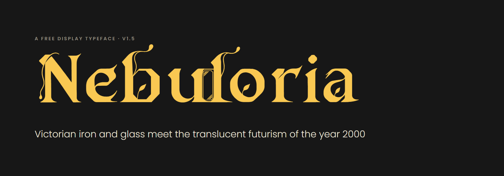
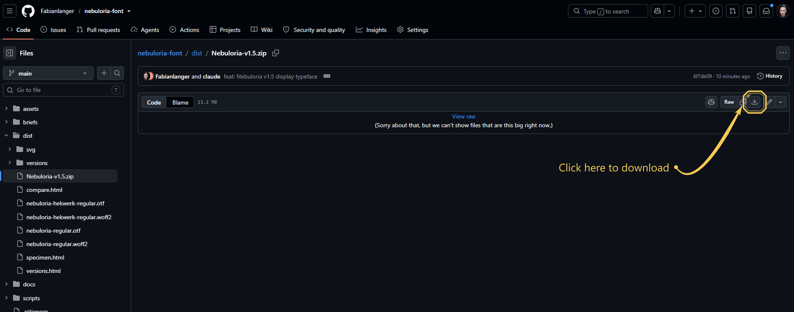

# Nebuloria



**Nebuloria** is a free display typeface where Victorian iron-and-glass architecture meets the translucent electronics, aerospace curves and microchip lines of the year 2000: an elegant, solarpunk letter for a future where technology and nature grow together.

Heavy strokes carry hair-thin tendrils, corners are cut at 45°, small leaves grow inside the letters, and optional extras open little glass **windows** between letters and hang **wires** from one letter to the next.

**Free for everyone**, for personal and commercial work.

---

## Get the font in 3 steps

### 1. Download

Download the **newest** version. At the time of writing that is **v1.5**; newer versions add more characters.

Click **[⬇ Nebuloria-v1.5.zip](dist/Nebuloria-v1.5.zip)**. On the page that opens, click the **download button** (the small arrow pointing down, on the right):



Then unzip it: double-click the file (Mac) or right-click → **Extract all** (Windows).

Inside you will find:

| Folder / file | What it is |
|---|---|
| `fonts/otf/` | The fonts to install on your computer |
| `fonts/webfonts/` | The fonts for websites |
| `Nebuloria-Design-Book.pdf` | The story behind the font, with examples |
| `Nebuloria-Style-Guide.pdf` | The design rules, plus AI prompts |
| `OFL.txt` | The licence |

### 2. Install

- **Windows:** open `fonts/otf`, select both files, right-click → **Install** (or **Install for all users**).
- **Mac:** double-click each file in `fonts/otf` → **Install Font**.

Restart your app if it was already open. You now have two styles in your font menu:

| Style | Looks like |
|---|---|
| **Nebuloria** | Calm and readable. At most one glass window per word. |
| **Nebuloria Hekwerk** | "Iron fence": a glass window between every pair of upright letters. |

### 3. Use

Choose **Nebuloria** in your app and use it **big**: names, titles, posters, covers, invitations, logos.
Set the rest of your text in a calm, simple font. Nebuloria is made for 40 px / 30 pt and larger.

---

## Switching on the windows and wires

The glass windows and the hanging wires are a hidden extra called **discretionary ligatures**. Where your app supports it:

| App | Where to find it |
|---|---|
| **Word** (Windows/Mac) | Font dialog (Ctrl+D / Cmd+D) → **Advanced** → Ligatures: **All** |
| **Figma** | Text → Type settings (the three dots) → **Details** → Discretionary ligatures |
| **Illustrator / InDesign** | Window → Type → **OpenType** → Discretionary Ligatures |
| **Photoshop** | Character panel → OpenType button → **Discretionary Ligatures** |
| **Affinity Designer / Publisher** | Typography panel → **Discretionary Ligatures** |

Want the iron fence? Simply choose **Nebuloria Hekwerk** instead.
Apps without these options (for example PowerPoint, Keynote or Canva) show the clean letters, which work just as well.

**Canva:** custom fonts can be uploaded with Canva Pro (Brand Kit → Upload a font → use the `.otf` files).
**Google Docs and Slides** cannot use installed fonts.

---

## Good to know

- **Letters only (for now).** Version 1.5 contains A–Z, a–z and the space. **Numbers, punctuation and accents (é, ü …) are not included yet**; your app will show them in another font. They are planned for a next version.
- **Big sizes only.** The fine hairlines need room. Below 30 pt / 40 px, use a different font.

## Make something in this style with AI

The **[style guide](docs/Nebuloria-Style-Guide.pdf)** contains a ready-to-copy **AI prompt** to create lettering in the Nebuloria style, plus correcting prompts for when the result goes wrong.
Easiest tip: **take a screenshot of the font and ask the AI to use that font.**

## Read more

- **[Design book (PDF)](docs/Nebuloria-Design-Book.pdf):** the inspiration, the six principles, the alphabet, mockups and how the font was made.
- **[Style guide (PDF)](docs/Nebuloria-Style-Guide.pdf):** the rules in numbers and the AI prompts.

## Licence

Nebuloria is free under the [SIL Open Font License 1.1](OFL.txt). You may use it for anything, personal or commercial, embed it, share it and change it. The only thing you may not do is sell the font on its own. Photographs in the design book come from Wikimedia Commons under their own licences (listed in the book).

---

## For web developers

```css
@font-face {
  font-family: "Nebuloria";
  src: url("nebuloria-regular.woff2") format("woff2");
  font-display: swap;
}
@font-face {
  font-family: "Nebuloria Hekwerk";
  src: url("nebuloria-hekwerk-regular.woff2") format("woff2");
  font-display: swap;
}

.wordmark { font-family: "Nebuloria", serif; font-size: 120px; font-feature-settings: "dlig" 1; }
.headline { font-family: "Nebuloria", serif; font-size: 64px; }           /* extras off */
.fence    { font-family: "Nebuloria", serif; font-feature-settings: "dlig" 1, "ss01" 1; }
```

| Feature | Regular | Hekwerk |
|---|---|---|
| `dlig` | Wires (*Fa La ng er re ce ge*) + at most one window per word | Wires + a window in every pair of stems |
| `ss01` | Window in every pair | Back to one window per word |

Metrics: 1000 units per em, cap height 700, x-height 500, ascender 904, descender −339.
Single files: [nebuloria-regular.woff2](dist/nebuloria-regular.woff2) · [nebuloria-hekwerk-regular.woff2](dist/nebuloria-hekwerk-regular.woff2) · [.otf](dist/nebuloria-regular.otf) · [Hekwerk .otf](dist/nebuloria-hekwerk-regular.otf).

## For type designers: building from source

The font is built with Python from traced glyph images (drawn with AI image models).

```bash
pip install fonttools brotli vtracer pillow numpy scipy
python scripts/prepare_glyphs.py         # cut and trace all drawings into build/glyphs + build/wires
python scripts/build_font.py --hekwerk   # dist/*.otf, *.woff2 (both styles)
python scripts/build_docs.py             # docs/*.pdf (needs Microsoft Edge)
```

| Script | Role |
|---|---|
| `scripts/prepare_glyphs.py` | The ordered list of drawings and metric corrections used for v1.5 |
| `scripts/segment.py` | Cuts a row of drawn letters into glyphs, measures baseline and x-height |
| `scripts/vectorize.py` | Traces a glyph image into vector outlines (vtracer) |
| `scripts/build_font.py` | Places, spaces and orients outlines and builds the OpenType font |
| `scripts/ligatures.py` | Window and wire ligatures (`dlig`, `ss01`) |
| `scripts/wire_ref.py`, `scripts/wire_extract.py` | Wires drawn over the font's own letters |
| `scripts/export_svg.py` | Exports words and components as clean SVG |
| `scripts/cover_grade.py` | Colour-grades the cover photographs |
| `scripts/build_docs.py` | Prints the design book and style guide to PDF |

Glyph drawings live in `assets/sheets/`, the prompts that produced them in `briefs/`.

---

Designed by [Fabian Langer](https://fabianlanger.nl), 2026.
